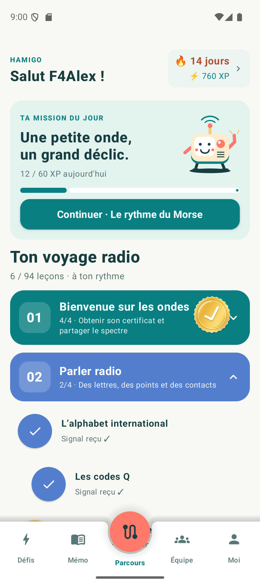
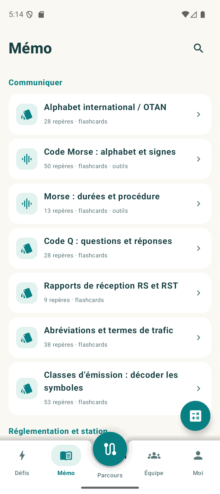
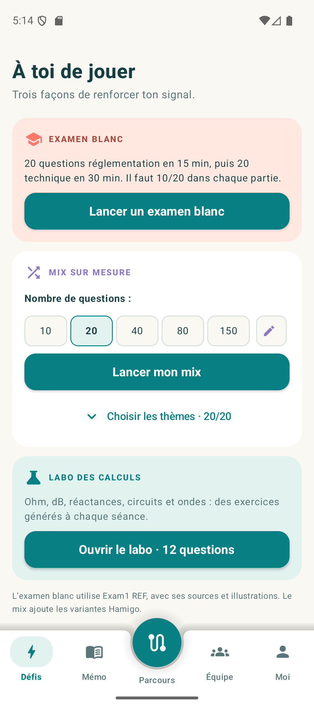
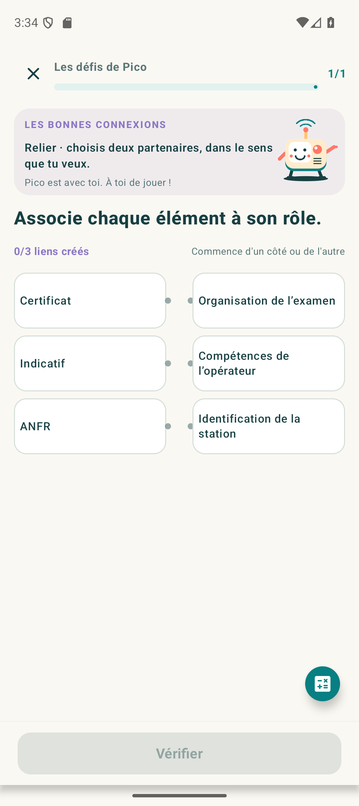
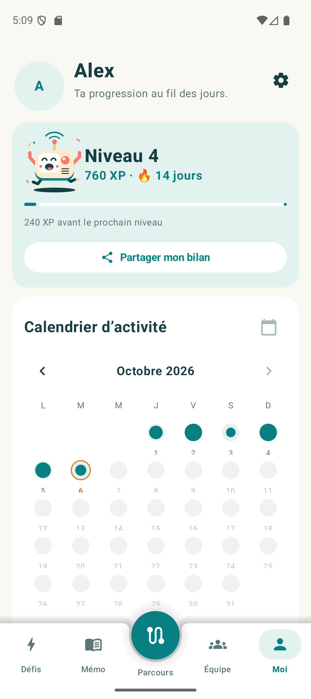
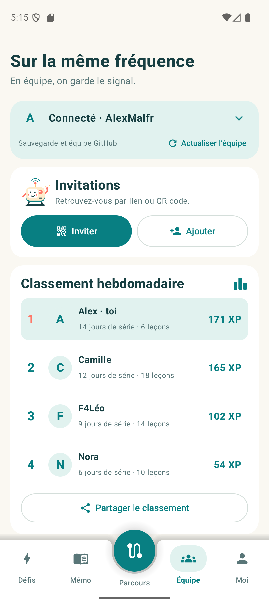
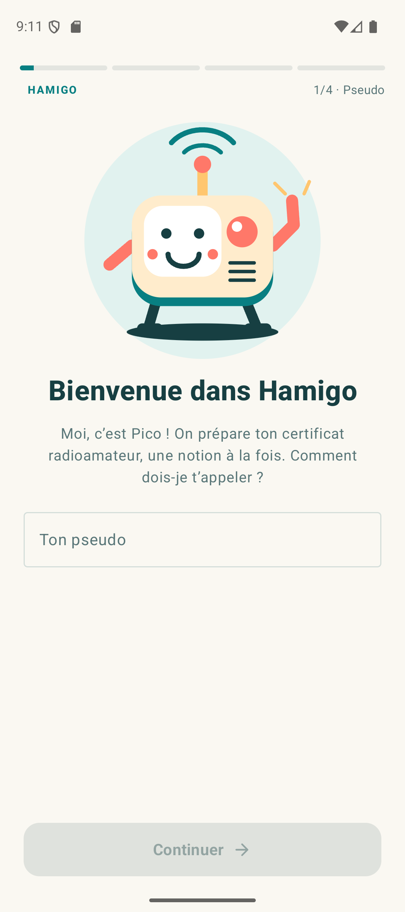
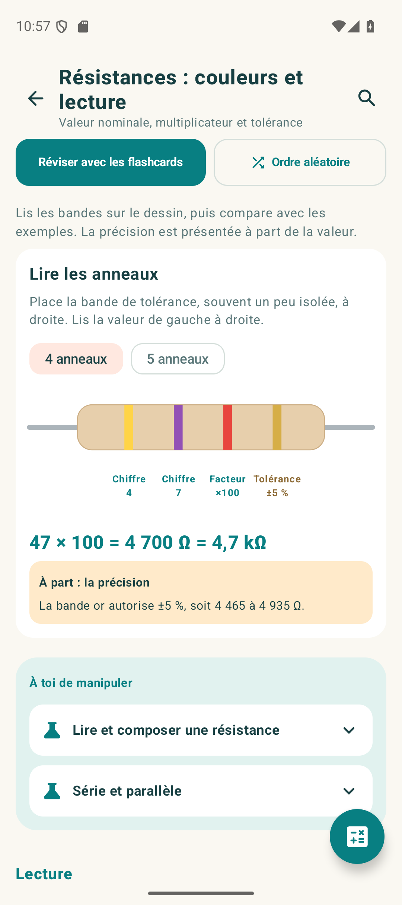

> [!WARNING]
> **Vibe codée avec ❤️ par [@AlexMalfr](https://github.com/AlexMalfr).**
> Hamigo est entièrement développée avec des agents IA (Codex), à partir d’idées, de retours et de tests humains.
>
> Je ne connais rien en RF (radiofréquences) : c’est justement pour apprendre que j’ai créé cette app. **Le contenu pédagogique peut contenir des erreurs.** Vérifie les notions importantes avec les cours de référence et les sources officielles.

# Hamigo 📻

**Apprends le radioamateurisme, une leçon à la fois.**

Hamigo est une application Android en français pour préparer le **certificat d’opérateur des services d’amateur**. Des leçons interactives, des révisions espacées et Pico, une petite radio qui t’accompagne dans ton apprentissage.

**[Télécharger l’APK](https://github.com/AlexMalfr/Hamigo/releases/latest)** · [Signaler un problème](https://github.com/AlexMalfr/Hamigo/issues) · [Documentation détaillée](docs/APP-DETAILS.md)

## Ce qu’on peut faire

- **Apprendre** avec un parcours unique de 13 sections, 64 chapitres et 173 leçons. Les nombres et l’électricité précèdent leurs applications ; le certificat arrive avant la fin des explorations radio. Des applications graduées et des reprises dans d’autres contextes consolident les notions. Le Morse revient par étapes, des premières lettres aux échanges. Deux cours pratiques aident à préparer l’inscription et le jour de l’examen, avec des liens ANFR. Le menu de chaque leçon permet de relire le cours et ses fiches mémo sans lancer les questions.
- **Manipuler** des quiz variés : associations et étapes à glisser, textes à trous, réponses indépendantes par ligne, résistances, fréquences, calculs, circuits à compléter et Morse. Les rappels libres et certaines réponses à l’oral entraînent la mémorisation ; le clavier reste toujours disponible. Le micro propose l’appui maintenu ou la bascule, avec un repère d’écoute et le niveau de voix fourni par Android. Des indicatifs, prénoms et distracteurs peuvent varier à chaque séance. Pico lit les questions, les consignes et les choix avec des phrases adaptées à l’oral ; sa bouche suit les pauses de l’audio. Les formules reconnues affichent leurs fractions, racines et indices.
- **Préparer ses réponses** avec une calculatrice scientifique adaptée au portrait et au paysage, et un brouillon au clavier, au doigt ou au stylet. Ils sont accessibles dans Mémo, les questions et les examens blancs ; leur contenu reste local à la fiche, au cours ou à la question.
- **Réviser** avec 40 fiches mémo, des flashcards et des outils interactifs : calculatrice, résistances, décibels, traducteur Morse, portes logiques… Pico accompagne les cours et les flashcards avec des expressions et des réactions discrètes.
- **S’entraîner** en examen blanc, avec un mix sur mesure ou des révisions des compétences étudiées. L’historique conserve les résultats, les corrections et les sujets à retravailler ; trois examens complets ouvrent un examen personnalisé. Deux barres dans Moi suivent séparément les cours utiles au certificat et à l’exploration.
- **Garder le rythme** avec un objectif quotidien, des XP, une série de jours, un calendrier, des rappels et des widgets redimensionnables, avec un fond transparent facultatif par widget.
- **Ressentir les interactions** avec de petits sons inspirés des commandes radio, des vibrations mesurées et des confettis de fin de séance. Sons et vibrations se désactivent séparément ; la composition Morse peut être écoutée en direct, avec un réglage dédié.
- **Jouer en équipe** : consulter le calendrier et les semaines d’un ami, son objectif et sa progression d’aujourd’hui, les ajouter par lien ou QR, comparer les XP dans un widget social avec Pico et partager un bilan avec les photos GitHub. Encourager partage une petite carte et ses statistiques. L’historique disponible dépend de son dernier résumé synchronisé. Les fins de séance montrent aussi l’objectif du jour et proposent leur propre image de résultats.
- **Faire un retour** depuis une question ou une fiche mémo : son identifiant et le contexte technique accompagnent le formulaire Tally commun, avec pièces jointes facultatives. Les introductions disposent aussi d’un drapeau.

Les cours peuvent être ignorés depuis leur menu, ou par appui long sur un chapitre. Après confirmation, ils comptent comme faits pour avancer, sans donner d’XP ni de preuve de maîtrise. Il faut les réintégrer pour les suivre et gagner les récompenses habituelles ; les révisions restent basées sur les réponses réelles.

Les révisions s’adaptent aux réponses. Une leçon demande au moins 80 % de bonnes réponses au premier essai et la correction des erreurs pour être validée.

## En images

Captures de l’application sur émulateur, avec des profils de démonstration. Clique sur une image pour l’agrandir.

| Parcours | Mémo | Défis |
|:---:|:---:|:---:|
| <a href="docs/screenshots/parcours.png"></a> | <a href="docs/screenshots/memo.png"></a> | <a href="docs/screenshots/defis.png"></a> |
| **Exercices interactifs** | **Moi** | **Équipe** |
| <a href="docs/screenshots/exercice.png"></a> | <a href="docs/screenshots/progression.png"></a> | <a href="docs/screenshots/equipe.png"></a> |

<details>
<summary>Voir aussi l’accueil et les outils des fiches mémo</summary>

| Premiers pas avec Pico | Résistances en couleurs |
|:---:|:---:|
| <a href="docs/screenshots/accueil.png"></a> | <a href="docs/screenshots/resistances.png"></a> |

</details>

## Installer Hamigo

**Android 8.0 ou plus récent.** Télécharge le fichier `Hamigo-…apk` depuis la [dernière release](https://github.com/AlexMalfr/Hamigo/releases/latest), puis installe-le sur ton téléphone.

Au premier lancement, tu choisis ton pseudo, ton objectif, l’heure de ton rappel et ta façon de saisir le Morse. La connexion GitHub est proposée ensuite ; elle reste facultative. Les cours, les fiches et les révisions fonctionnent **hors ligne**. La banque Exam’1 se télécharge automatiquement pendant l’accueil, puis reste disponible hors ligne. Ses mises à jour sont vérifiées en arrière-plan ; sa version et la vérification manuelle se trouvent dans les paramètres.

Un guide avec Pico présente ensuite le cours de bienvenue et les autres onglets. La première étape assombrit la page, puis le dernier encouragement se détache sur un voile léger ; le guide laisse lire le cours et répondre aux questions, puis reprend au bilan. La visite des onglets avance en les touchant. Le tutoriel peut être passé après confirmation. Un essai du micro dans l’accueil explique la permission ; le clavier reste disponible en cas de refus. Le service Android traite l’audio, sans enregistrement par Hamigo. Le mode appui maintenu ou bascule est synchronisé avec les autres réglages de jeu.

## Sauvegarde et équipe

GitHub sert à retrouver sa progression sur plusieurs appareils et à partager ses statistiques avec ses amis, sans serveur applicatif Hamigo.

Deux Gists séparés conservent la sauvegarde complète et le résumé social. Ils sont **non répertoriés, mais accessibles à toute personne possédant leur lien** ; la sauvegarde n’est pas chiffrée. L’invitation ne donne accès qu’au résumé social.

Pour les échanges, les demandes d’amis et la fusion des sauvegardes : [fonctionnement de la synchronisation](docs/SOCIAL.md).

## Développer

Ouvre le projet dans Android Studio avec **JDK 17 ou plus** et le **SDK Android 36**. Configure le chemin du SDK dans `local.properties` ou `ANDROID_HOME`, puis :

```sh
./gradlew :app:assembleDebug :app:testDebugUnitTest
```

Sous Windows, utilise `gradlew.bat`. Les builds Windows sont isolés hors de OneDrive, dans `%LOCALAPPDATA%/Hamigo/build/<checkout>/app/` ; `gradlew.bat -q :app:printBuildDirectory` donne le chemin. Sur les autres systèmes : `app/build/outputs/apk/debug/`.

La signature, la configuration OAuth, les versions et les vérifications Android sont expliquées dans [les notes techniques](docs/APP-DETAILS.md) et [la documentation OAuth](docs/GITHUB-PKCE.md).

Pour tester directement un identifiant de question, parcourir les formats ou inspecter des données fictives sans modifier sa progression : [outils de diagnostics sur appareil](docs/DIAGNOSTICS.md). Pour personnaliser le fond des widgets : [configuration des widgets](docs/WIDGET-CONFIGURATION.md).

Les questions originales du Parcours utilisent des [UUID stables séparés de leur position](docs/QUESTION-IDENTITIES.md). Déplacer une question conserve son historique ; la conversion temporaire des sauvegardes 0.47–0.51 a été retirée en 0.52, comme prévu.

Le parcours s’édite dans `data/curriculum.json`, avec les questions complètes. `node tools/expand_curriculum.mjs` génère `app/src/main/assets/curriculum.json` (introductions et références `questionIds`) et la banque `course-questions.json` lue par Android. Les deux fichiers `curriculum.json` ont donc des rôles différents et doivent être conservés ; ne pas modifier directement la version distribuée. La [présentation des introductions](docs/LESSON-PRESENTATION.md) s’édite séparément dans `data/lesson-presentation.json` : sous-titres, idées clés, astuces et aperçus de cours, sans balises dans la narration.

## Sources et documentation

Hamigo est un projet indépendant de l’ANFR. Le contenu continue d’être revu et enrichi.

- [Cours F6KGL / F5KFF](http://f6kgl.free.fr/COURS.html) — référence pédagogique, sous **CC BY-NC-SA 4.0** ; [attributions et textes officiels](docs/SOURCES-COURSES.md).
- [Exam1 REF](https://exam1.r-e-f.org/) — banque communautaire d’entraînement ; [provenance et statut des ressources](docs/SOURCES-EXAM1.md).
- [ANFR](https://www.anfr.fr/gerer/radioamateurs/les-certificats) — informations officielles sur le certificat.

Pour aller plus loin : [couverture des fiches mémo](docs/MEMO-COVERAGE-2026-10.md) · [validation et limites](docs/VALIDATION.md) · [historique des mises à jour](docs/UPDATES-2026-10.md) · [consignes de contribution pour les agents](AGENTS.md).
